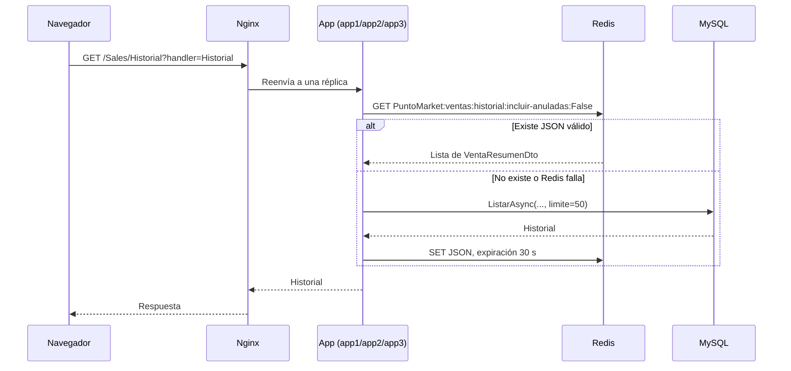
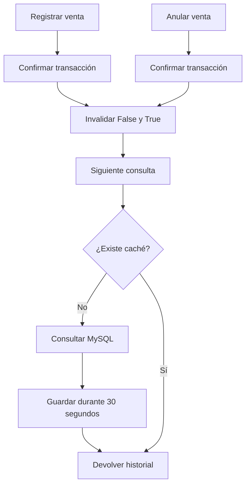
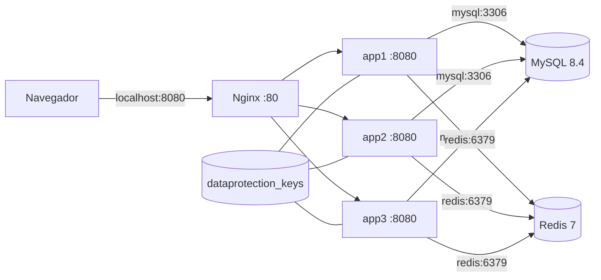

# Cambios técnicos del proyecto PuntoMarket

## 1. Introducción y objetivo de los cambios

Este documento describe los cambios técnicos que se encuentran actualmente en
el repositorio `Proyecto_Arquitectura_Micromercado`. El análisis se realizó
sobre el estado de trabajo local, incluyendo `git status`, `git diff`,
`git diff --stat`, los archivos nuevos de Docker/Redis/Nginx, las clases
relacionadas con ventas y las pruebas asociadas.

El cambio técnico principal es la incorporación de caché distribuida con Redis
para el historial de ventas, junto con la invalidación de esa caché después de
registrar o anular una venta. Para soportar un despliegue con varias réplicas
también se añadieron una imagen Docker de la aplicación, tres instancias de la
aplicación, Redis, MySQL y un proxy inverso Nginx.

El documento distingue entre:

- comportamiento confirmado por el código;
- configuración que existe pero requiere completar o validar en el entorno;
- resultados de pruebas realmente ejecutadas.

No se modificó el código como parte de este análisis.

## 2. Estado anterior y problemas que se buscaba resolver

### 2.1 Historial de ventas

Antes del cambio, `VentaConsultaService.ListarAsync` consultaba directamente
`IVentaConsultaRepository`. Cada solicitud del historial terminaba consultando
la persistencia, aunque la consulta devuelve como máximo 50 registros y varios
usuarios o réplicas podían solicitar los mismos datos repetidamente.

El problema que aborda Redis es reducir consultas repetidas a MySQL y compartir
el resultado entre las réplicas `app1`, `app2` y `app3`. La caché no reemplaza a
MySQL: si no hay un valor válido en Redis, el servicio consulta el repositorio,
devuelve el resultado y trata de guardarlo durante 30 segundos.

### 2.2 Cambios de datos

Una venta nueva o una anulación modifica el resultado del historial. Si se
conservara la respuesta anterior, el historial podría mostrar datos obsoletos
durante el tiempo de vida de la caché. Por eso las fachadas invalidan las dos
variantes del historial después de confirmar la transacción.

### 2.3 Despliegue

La configuración añadida permite ejecutar la aplicación detrás de Nginx y
distribuir las solicitudes entre tres contenedores de aplicación. Redis y
MySQL se resuelven por nombre de servicio dentro de la red de Docker Compose.
Las claves de Data Protection se almacenan en un volumen compartido para que
las réplicas puedan proteger y leer cookies de autenticación de forma
consistente.

## 3. Resumen general de las modificaciones

| Área | Archivos | Cambio confirmado |
|---|---|---|
| Caché de ventas | `Application/Sales/VentaConsultaService.cs` | Lectura, escritura, expiración e invalidación de caché mediante `IDistributedCache`. |
| Contrato | `Application/Sales/IVentaConsultaService.cs` | Nuevo método `InvalidarHistorialAsync`. |
| Escritura de ventas | `Application/Facades/FachadaVenta.cs` | Invalida el historial después de confirmar una venta. |
| Anulación | `Application/Facades/FachadaAnulacion.cs` | Invalida el historial después de confirmar una anulación. |
| Composición | `Program.cs` | Registra Redis, Data Protection compartida y el identificador de réplica. |
| Interfaz | `Pages/Shared/_Layout.cshtml` | Muestra la réplica que atendió la solicitud. |
| Contenedores | `Dockerfile`, `docker-compose.yml`, `nginx/nginx.conf` | Añade build de la aplicación, MySQL, Redis, tres réplicas y proxy Nginx. |
| Configuración de entorno | `.env.example`, `.dockerignore`, `.gitignore` | `.env.example` documenta las cuatro variables que Compose consume; `.dockerignore` sigue vacío y `.gitignore` excluye secretos locales. |
| Base de datos | `bdMicroMercadoArqui.sql` | Añade `SET NAMES utf8mb4` antes de crear la base de datos. |
| Pruebas | `HistorialAutorizacionTests.cs`, `SalesHistorialHandlerTests.cs` | Añaden implementaciones vacías de `InvalidarHistorialAsync` a dobles del contrato. |

El estado de trabajo también contiene cambios documentales y eliminaciones de
documentos anteriores (`EXPLICACION_ESTRUCTURA_ACTUAL.md`,
`PROJECT_STRUCTURE_ACTUAL.md`, `FACTORY_METHOD_ESTRUCTURA_FINAL.md` y
`GUIA_IMPLEMENTACION_FACTORY_METHOD.md`). Esos cambios no implementan la
funcionalidad de Redis, ventas o Docker y no se atribuyen a ella.

## 4. Explicación técnica por funcionalidad

### 4.1 Redis y caché del historial

`VentaConsultaService` recibe ahora:

- `IVentaRepository`, para consultas ya existentes como las ventas del día;
- `IVentaConsultaRepository`, para listar y consultar el detalle;
- `IDistributedCache`, para Redis;
- `ILogger<VentaConsultaService>`, para registrar fallos de caché.

`ListarAsync(bool incluirAnuladas, CancellationToken)` construye la clave
lógica:

```text
ventas:historial:incluir-anuladas:{incluirAnuladas}
```

El registro de Redis agrega el prefijo configurado en `Program.cs`,
`PuntoMarket:`. Por eso la clave completa observada para el filtro `false` es:

```text
PuntoMarket:ventas:historial:incluir-anuladas:False
```

La clave significa lo siguiente:

- `PuntoMarket`: prefijo común configurado en `options.InstanceName`;
- `ventas`: funcionalidad que produce el dato;
- `historial`: listado histórico, no el detalle individual;
- `incluir-anuladas`: parámetro que diferencia las consultas;
- `False`: la consulta excluye ventas anuladas.

El flujo de lectura es:

1. El servicio intenta leer la cadena JSON con `cache.GetStringAsync`.
2. Si existe y se deserializa correctamente como `List<VentaResumenDto>`, la
   respuesta sale de Redis.
3. Si no existe, está vacía o Redis produce una excepción, se consulta
   `IVentaConsultaRepository.ListarAsync` con el límite 50.
4. El resultado se serializa y se guarda con expiración absoluta de 30 segundos.
5. Si Redis no está disponible, se registra una advertencia y la consulta de
   MySQL continúa funcionando.

El servicio no almacena el detalle de una venta en esta caché. El método
`ObtenerDetalleAsync` sigue consultando directamente
`IVentaConsultaRepository`.

### 4.2 Invalidación al cambiar ventas

`InvalidarHistorialAsync` elimina explícitamente estas dos claves lógicas:

```text
ventas:historial:incluir-anuladas:False
ventas:historial:incluir-anuladas:True
```

Con el prefijo de Redis, ambas se almacenan bajo `PuntoMarket:`.

`FachadaVenta.RegistrarEnUnaTransaccionAsync` llama a la invalidación después
de `unidad.ConfirmarAsync`. `FachadaAnulacion.AnularVentaAsync` aplica el mismo
orden después de confirmar la restauración de lotes y el cambio de estado de la
venta. Las fachadas usan `CancellationToken.None` para que la limpieza de la
caché no dependa de la cancelación de la petición original.

Si la operación de caché falla, `VentaConsultaService` registra una advertencia
por cada clave, pero no revierte una transacción de negocio ya confirmada. En
ese caso, la expiración de 30 segundos limita la duración máxima de un valor
potencialmente obsoleto.

### 4.3 Redis, autenticación y sesiones

`Program.cs` registra `AddStackExchangeRedisCache`, por lo que el servicio
distribuido utilizado por `AddSession` queda respaldado por Redis. Esto permite
que el estado de sesión pueda ser compartido por las réplicas, siempre que la
aplicación realmente use datos de sesión.

La autenticación configurada es `CookieAuthentication`. La cookie no se guarda
en Redis por este código. Sin embargo, las claves criptográficas para
protegerla se persisten mediante:

```csharp
.PersistKeysToFileSystem(new DirectoryInfo("/keys"))
.SetApplicationName("PuntoMarket");
```

Docker Compose monta el volumen `dataprotection_keys` en `/keys` para `app1`,
`app2` y `app3`. Esto es una configuración de persistencia compartida de Data
Protection, distinta de la caché de historial.

### 4.4 Cambios en la lógica y arquitectura de ventas

#### `Application/Facades/FachadaVenta.cs`

La fachada conserva la responsabilidad de validar la venta, abrir la unidad de
trabajo, insertar cabecera y detalle, descontar stock, cerrar la venta y
confirmar la transacción. El cambio es la dependencia adicional
`IVentaConsultaService consultaVentas` y la invalidación posterior a la
confirmación.

La invalidación está después de `ConfirmarAsync`; por tanto, una transacción
revertida no invalida el historial como si hubiera existido una venta
confirmada.

#### `Application/Facades/FachadaAnulacion.cs`

La fachada sigue validando la venta y el motivo, restaura lotes y marca la venta
como anulada dentro de la unidad de trabajo. El cambio es recibir
`IVentaConsultaService` y eliminar ambas variantes del historial después de
confirmar la anulación.

#### `Application/Sales/IVentaConsultaService.cs`

El contrato conserva las operaciones de ventas del día, listado y detalle, y
añade:

```csharp
Task InvalidarHistorialAsync(
    CancellationToken cancellationToken = default);
```

La nueva operación permite que las fachadas dependan del contrato de consulta
sin conocer Redis ni `IDistributedCache`.

#### `Application/Sales/VentaConsultaService.cs`

Es el adaptador de aplicación que encapsula la política de caché. La
serialización usa `System.Text.Json`; la caché se limita al listado del
historial, tiene expiración absoluta de 30 segundos y maneja fallos de Redis
como degradación a MySQL con logging.

#### `Program.cs`

Además de los registros existentes, ahora:

- configura Redis usando `ConnectionStrings:Redis`, con fallback a
  `redis:6379`;
- usa el prefijo `PuntoMarket:`;
- persiste Data Protection en `/keys`;
- calcula `REPLICA_ID` o utiliza `Environment.MachineName`;
- añade `X-Replica-Id` a la respuesta y coloca el mismo valor en
  `HttpContext.Items["ReplicaId"]`.

El archivo contiene dos middlewares consecutivos que asignan `ReplicaId` y la
cabecera `X-Replica-Id`; ambos realizan la misma operación. El segundo no añade
un comportamiento distinto al primero.

#### `Pages/Shared/_Layout.cshtml`

El layout muestra `Context.Items["ReplicaId"]` como una etiqueta
`Instancia: ...`. Esta modificación sirve para observar visualmente qué
réplica atendió la página cuando Nginx distribuye solicitudes.

## 5. Explicación de los archivos modificados y nuevos

### 5.1 Docker y Redis

#### `Dockerfile`

Es un build multi-etapa:

1. `mcr.microsoft.com/dotnet/sdk:10.0` restaura y publica el proyecto en
   configuración `Release`.
2. `mcr.microsoft.com/dotnet/aspnet:10.0` recibe únicamente el resultado
   publicado.

La aplicación escucha en `http://+:8080` dentro del contenedor y expone el
puerto 8080 del contenedor. El acceso externo de Compose se realiza a través de
Nginx, no mediante un puerto publicado individualmente por `app1`, `app2` o
`app3`.

#### `docker-compose.yml`

Define estos servicios:

| Servicio | Imagen/puerto | Responsabilidad |
|---|---|---|
| `mysql` | `mysql:8.4`, sin puerto host publicado | Base de datos y ejecución inicial de `bdMicroMercadoArqui.sql`. |
| `redis` | `redis:7-alpine`, sin puerto host publicado | Caché distribuida y backend del proveedor de caché distribuida. |
| `app1`, `app2`, `app3` | Construidos desde `Dockerfile`, puerto interno 8080 | Tres réplicas de la aplicación ASP.NET Core. |
| `nginx` | `nginx:alpine`, `8080:80` | Punto de entrada externo y balanceo entre las réplicas. |

MySQL usa el volumen `mysql_data` y monta el script SQL como
`/docker-entrypoint-initdb.d/001-init.sql` en modo solo lectura. Redis tiene un
healthcheck con `redis-cli ping`.

Cada réplica recibe:

- `ASPNETCORE_ENVIRONMENT=Production`;
- `ASPNETCORE_URLS=http://+:8080`;
- `REPLICA_ID` con `app1`, `app2` o `app3`;
- `ConnectionStrings__Redis=redis:6379`;
- la cadena de conexión MySQL con el nombre de servicio `mysql` y variables de
  base de datos/usuario del entorno.

Las réplicas esperan que MySQL y Redis estén saludables mediante `depends_on`
con condición `service_healthy`. Nginx depende de las tres aplicaciones, pero
su `depends_on` no define un healthcheck propio de las aplicaciones.

El archivo declara los volúmenes nombrados `mysql_data` y
`dataprotection_keys`. No publica directamente los puertos de MySQL ni Redis al
host; la comunicación se realiza por la red interna de Compose.

#### `nginx/nginx.conf`

Nginx define el upstream `puntomarket_backend` con `app1:8080`, `app2:8080` y
`app3:8080`. La ruta `/` usa `proxy_pass` hacia ese upstream y el puerto 80
del contenedor Nginx se publica como el puerto 8080 del host.

También reenvía `Host`, `X-Real-IP`, `X-Forwarded-For` y
`X-Forwarded-Proto`. No se observa configuración de TLS, persistencia de
afinidad, límites de conexión ni healthchecks activos en Nginx.

#### `.env.example`

El archivo contiene las cuatro variables que `docker-compose.yml` realmente
consume:

```dotenv
MYSQL_ROOT_PASSWORD=change_me_root_password
MYSQL_DATABASE=bdMicroMercadoArqui
MYSQL_USER=puntomarket
MYSQL_PASSWORD=change_me_app_password
```

Son valores de ejemplo y no deben usarse como contraseñas de un entorno
compartido. El archivo `.env` queda excluido por `.gitignore`, mientras que la
regla `!.env.example` permite versionar esta plantilla. `REPLICA_ID`,
`ASPNETCORE_ENVIRONMENT`, `ASPNETCORE_URLS` y las cadenas internas de Redis y
MySQL no se agregan a la plantilla porque Compose las define directamente por
servicio; no son variables requeridas por el usuario en `.env`.

#### `.dockerignore`

El archivo está presente pero vacío. Por tanto, no documenta exclusiones
adicionales del contexto de build. La configuración de exclusiones de Git no
equivale automáticamente a una configuración de Docker.

### 5.2 Configuración y base de datos

#### `.gitignore`

Además de `bin/`, `obj/` y `.vs`, ahora ignora `.git`, archivos `*.user`,
`appsettings.json`, archivos `.env` y `.env.*`, permitiendo explícitamente
`.env.example`. Esto reduce el riesgo de versionar secretos y configuraciones
locales. El archivo también conserva una regla para
`appsettings.Development.json`.

#### `bdMicroMercadoArqui.sql`

Añade `SET NAMES utf8mb4;` antes de eliminar y crear la base de datos. Esto
establece explícitamente la codificación de la conexión SQL para que caracteres
como tildes y la `ñ` se interpreten correctamente durante la inicialización.
El resto del script conserva la creación del esquema y los datos definidos
previamente.

### 5.3 Pruebas modificadas

Los dobles `ConsultaVacia` y `ConsultaPrueba` de
`HistorialAutorizacionTests.cs` y `SalesHistorialHandlerTests.cs` implementan
el nuevo método `InvalidarHistorialAsync` con `Task.CompletedTask`. Es un ajuste
de contrato para que esos dobles puedan continuar implementando
`IVentaConsultaService`; no prueba la integración real con Redis.

## 6. Flujo de funcionamiento de Redis y la caché de ventas



Después de una venta confirmada o una anulación confirmada:



La invalidación ocurre en todas las réplicas porque Redis es un servicio común
del despliegue. Si una instancia escribe la caché, las demás pueden leer la
misma clave.

Para comprobarlo con `redis-cli`, desde un entorno donde Redis sea accesible:

```bash
redis-cli PING
redis-cli SCAN 0 MATCH 'PuntoMarket:ventas:historial:*' COUNT 100
redis-cli GET 'PuntoMarket:ventas:historial:incluir-anuladas:False'
redis-cli TTL 'PuntoMarket:ventas:historial:incluir-anuladas:False'
```

Con Docker Compose, el comando equivalente puede ejecutarse dentro del
contenedor:

```bash
docker compose exec redis redis-cli PING
docker compose exec redis redis-cli SCAN 0 MATCH 'PuntoMarket:ventas:historial:*' COUNT 100
```

Después de registrar o anular una venta, se espera que `GET` devuelva ausencia
de valor hasta que una nueva consulta recargue la clave desde MySQL. Esta
comprobación requiere un despliegue iniciado y una operación real de venta; no
se ejecutó como parte de este análisis.

## 7. Arquitectura y comunicación entre los servicios



La resolución `mysql` y `redis` corresponde a nombres de servicio de Docker
Compose, no a `localhost`. El único puerto publicado al host por esta
configuración es `8080` del servicio Nginx. Los puertos internos indicados se
usan entre contenedores.

El identificador `REPLICA_ID` aparece en la cabecera `X-Replica-Id` y en el
layout. Esto ayuda a comprobar visualmente y mediante herramientas HTTP que
Nginx está distribuyendo solicitudes entre réplicas.

## 8. Guía para levantar el proyecto con Docker

### 8.1 Requisitos previos

Se necesita:

- Git para clonar el repositorio.
- Docker Desktop actualizado, con Docker Compose disponible mediante
  `docker compose`.
- Virtualización habilitada en Docker Desktop.
- El puerto `8080` libre en el equipo anfitrión.
- Acceso a Internet durante el primer build para descargar las imágenes
  `mysql:8.4`, `redis:7-alpine`, `nginx:alpine` y las imágenes .NET 10.

No es necesario instalar MySQL, Redis, Nginx ni el SDK de .NET en el equipo
anfitrión para ejecutar el entorno definido por Compose.

### 8.2 Clonar y crear `.env`

Reemplace la URL por la URL real del repositorio si se utiliza otro remoto:

```bash
git clone <URL_DEL_REPOSITORIO> Proyecto_Arquitectura_Micromercado
cd Proyecto_Arquitectura_Micromercado
```

Copie la plantilla y edite las contraseñas de ejemplo. En PowerShell:

```powershell
Copy-Item .env.example .env
notepad .env
```

En Linux/macOS:

```bash
cp .env.example .env
nano .env
```

El archivo `.env` debe conservar estas cuatro variables, porque son las únicas
interpoladas por `docker-compose.yml`:

```dotenv
MYSQL_ROOT_PASSWORD=una_contraseña_segura_para_root
MYSQL_DATABASE=bdMicroMercadoArqui
MYSQL_USER=puntomarket
MYSQL_PASSWORD=otra_contraseña_segura_para_la_aplicacion
```

No se deben subir las contraseñas reales. `.gitignore` excluye `.env` y
permite `.env.example`.

### 8.3 Validar la configuración y arrancar

Desde la raíz del repositorio, valide primero la interpolación:

```bash
docker compose --env-file .env config
```

Este comando muestra la configuración resultante sin iniciar contenedores. Si
faltan variables, Compose lo indicará; revise que `.env` exista y tenga las
cuatro claves.

Construya la imagen de la aplicación e inicie todos los servicios en segundo
plano:

```bash
docker compose --env-file .env up -d --build
```

`--build` publica la aplicación desde el `Dockerfile`; `-d` deja los
contenedores ejecutándose en segundo plano. Compose inicia `mysql`, `redis`,
`app1`, `app2`, `app3` y `nginx`, esperando los healthchecks de MySQL y Redis
antes de iniciar las réplicas de la aplicación.

La URL de acceso es:

```text
http://localhost:8080
```

El puerto 8080 del host llega al puerto 80 de Nginx. Nginx reenvía la
solicitud a una de las aplicaciones en el puerto interno 8080.

### 8.4 Comprobar contenedores, logs y Redis

Ver el estado de todos los servicios:

```bash
docker compose ps
```

Ver los logs recientes de todo el entorno:

```bash
docker compose logs --tail=200
```

Seguir los logs de las réplicas y del proxy:

```bash
docker compose logs -f nginx app1 app2 app3
```

Comprobar el estado de Redis:

```bash
docker compose exec redis redis-cli PING
docker compose exec redis redis-cli SCAN 0 MATCH 'PuntoMarket:ventas:historial:*' COUNT 100
```

El primer comando debe responder `PONG`. El segundo lista las claves de
historial encontradas; puede no mostrar ninguna si todavía no se consultó el
historial o si la caché expiró.

Comprobar el endpoint a través de Nginx y observar la réplica atendiente:

```bash
curl -i http://localhost:8080/
```

La respuesta puede incluir la cabecera `X-Replica-Id: app1`, `app2` o `app3`.
El layout también muestra `Instancia: ...` cuando la página se renderiza.

### 8.5 Detener, reiniciar y conservar datos

Detener y eliminar los contenedores, conservando los volúmenes:

```bash
docker compose down
```

Iniciar nuevamente los contenedores existentes:

```bash
docker compose up -d
```

Reiniciar los servicios sin eliminar los volúmenes:

```bash
docker compose restart
```

Reconstruir la imagen después de cambios en el proyecto y arrancar:

```bash
docker compose up -d --build
```

`mysql_data` conserva la base de datos y `dataprotection_keys` conserva las
claves compartidas de Data Protection. Redis no tiene un volumen declarado,
por lo que su caché se pierde si el contenedor se elimina o reinicia; los
datos persistentes del negocio permanecen en MySQL.

Para eliminar también los volúmenes y empezar de cero:

```bash
docker compose down -v
```

Este comando elimina `mysql_data` y `dataprotection_keys`. Al iniciar de nuevo,
MySQL ejecutará `bdMicroMercadoArqui.sql` solamente sobre una base de datos
nueva. No use `down -v` si necesita conservar ventas, usuarios u otros datos.

### 8.6 Problemas frecuentes

| Problema | Diagnóstico y solución |
|---|---|
| Compose indica variables faltantes | Confirme que `.env` esté en la raíz, que provenga de `.env.example` y que contenga `MYSQL_ROOT_PASSWORD`, `MYSQL_DATABASE`, `MYSQL_USER` y `MYSQL_PASSWORD`. Ejecute `docker compose --env-file .env config`. |
| El puerto 8080 está ocupado | Detenga el proceso que lo usa o cambie el mapeo de puertos en una configuración local. No se cambió `docker-compose.yml` en este trabajo. |
| `app1`, `app2` o `app3` no inicia | Revise `docker compose logs app1 app2 app3`; confirme que MySQL y Redis estén saludables con `docker compose ps`. |
| MySQL no queda saludable | Revise `docker compose logs mysql`. Si el volumen ya contiene una instalación anterior, el script de `/docker-entrypoint-initdb.d/` no se vuelve a aplicar; para reinicializar, use `docker compose down -v`, con pérdida de datos. |
| No se puede entrar a la aplicación | Compruebe `docker compose ps`, `docker compose logs nginx` y que la URL sea `http://localhost:8080`, no el puerto interno 8080 de una réplica. |
| No aparece una clave en Redis | Consulte primero el historial de ventas, luego repita `SCAN`. La clave expira en 30 segundos y también se elimina al crear o anular una venta. |
| La sesión o autenticación no funciona entre réplicas | Compruebe que las tres réplicas monten `dataprotection_keys:/keys` y que el volumen exista. Las cookies son de autenticación y Redis no almacena directamente la cookie. |
| El build falla al restaurar paquetes | Revise la conexión a Internet, libere espacio de Docker y vuelva a intentar `docker compose up -d --build`. |

## 9. Pruebas realizadas y comandos de verificación

### 8.1 Inspección del repositorio

Se ejecutaron:

```bash
git status --short
git diff --stat
git diff --name-status
git diff --numstat
git log -1 --oneline
```

El último commit observado fue `c3fc7a8 feat: add Redis caching dependency`.
El estado de trabajo contiene cambios de código, documentación, SQL y archivos
nuevos de despliegue. Este documento se crea como archivo adicional.

### 8.2 Prueba dirigida ejecutada

Se intentó ejecutar:

```bash
dotnet test Proyecto_Arquitectura_Micromercado.Tests/Proyecto_Arquitectura_Micromercado.Tests.csproj \
  --filter "FullyQualifiedName~HistorialAutorizacionTests|FullyQualifiedName~SalesHistorialHandlerTests" \
  --no-restore
```

Resultado: **falló durante la compilación**, por lo que no se ejecutaron los
tests filtrados. Los errores principales fueron `CS7036` por constructores que
todavía no reciben las nuevas dependencias:

- `VentaConsultaService` requiere `IDistributedCache` y
  `ILogger<VentaConsultaService>`, pero `VentaConsultaServiceTests.cs` usa la
  firma anterior.
- `FachadaVenta` requiere `IVentaConsultaService`, pero existen instancias
  antiguas en `FachadaAnulacionTests.cs`, `FachadaVentaTests.cs`,
  `HistorialAutorizacionTests.cs` y `StockActualMySqlTests.cs`.
- `FachadaAnulacion` requiere `IVentaConsultaService`, con el mismo problema en
  varias instancias de prueba.

Los dos archivos solicitados de historial sí fueron ajustados para implementar
el nuevo método del contrato, pero el conjunto de compilación incluye otros
tests que aún no fueron adaptados. Por tanto, no se afirma que las pruebas
pasen.

### 8.3 Comandos de verificación de despliegue

No se ejecutaron `docker compose up`, `docker compose config` ni `redis-cli`.
Una verificación posterior, después de proporcionar un `.env` válido, puede
usar:

```bash
docker compose config
docker compose up --build
docker compose ps
docker compose logs nginx app1 app2 app3 redis mysql
curl -i http://localhost:8080/
```

Estos comandos permitirían comprobar la interpolación de variables, el estado
de los healthchecks, el proxy, la cabecera `X-Replica-Id` y la conectividad de
Redis/MySQL.

## 10. Decisiones técnicas y justificación

1. **Usar `IDistributedCache` en lugar de Redis directamente.**  
   La lógica de aplicación depende de una abstracción de caché y no de una
   API específica de Redis. `AddStackExchangeRedisCache` proporciona la
   implementación distribuida para el despliegue.

2. **Separar las claves por `incluirAnuladas`.**  
   Un historial que incluye anuladas no es equivalente a uno que las excluye.
   Dos claves evitan devolver una respuesta con un filtro incorrecto.

3. **Usar expiración absoluta de 30 segundos.**  
   Es una ventana corta para disminuir lecturas repetidas sin mantener
   indefinidamente datos de ventas potencialmente antiguos. La invalidación
   explícita reduce aún más la ventana después de cambios.

4. **Degradar a MySQL cuando Redis falla.**  
   Redis es una optimización del historial en este diseño. Los `try/catch`
   específicos registran la incidencia y mantienen disponible la consulta de
   negocio.

5. **Invalidar después de confirmar la transacción.**  
   Así se evita borrar la caché por una operación que terminó en rollback.

6. **Compartir claves de Data Protection.**  
   En un despliegue con varias réplicas, todas deben poder leer las claves
   usadas para proteger datos de autenticación. El volumen `dataprotection_keys`
   evita que cada contenedor tenga un anillo independiente.

7. **Mantener MySQL y Redis internos.**  
   La configuración publica solo Nginx y limita el acceso externo directo a
   las bases de datos y al caché.

## 11. Consideraciones, limitaciones y posibles mejoras

- `.env.example` contiene una plantilla sin secretos para las cuatro variables
  de MySQL. Cada integrante debe copiarla a `.env` y cambiar las contraseñas
  antes de iniciar el entorno.
- `.dockerignore` está vacío. Conviene excluir `.git`, `.vs`, `bin`, `obj`,
  archivos de configuración local y otros artefactos antes de usar builds
  frecuentes o CI.
- La cadena de conexión MySQL en Compose contiene un componente de contraseña
  que no se reproduce aquí por seguridad. Debe comprobarse que su valor real se
  obtenga de una variable de entorno y no de un secreto escrito en el archivo.
- `Program.cs` contiene dos middlewares consecutivos que asignan la misma
  réplica y cabecera. El segundo parece redundante y debería revisarse.
- Las firmas nuevas no fueron propagadas a todos los constructores de tests.
  Antes de considerar completa la integración, hay que actualizar los dobles y
  ejecutar nuevamente la suite.
- `InvalidarHistorialAsync` elimina claves conocidas; no usa un patrón de
  búsqueda en Redis. Esto es simple y seguro para las dos variantes actuales,
  pero cualquier nueva dimensión del filtro debe añadirse explícitamente.
- El caché no coordina concurrencia entre solicitudes que detectan un miss al
  mismo tiempo. Varias solicitudes podrían consultar MySQL simultáneamente.
- Nginx no tiene healthchecks propios ni configuración explícita de afinidad o
  TLS. Estas capacidades podrían ser necesarias en un entorno productivo.
- La consulta cacheada tiene un límite fijo de 50 registros. Si el historial
  requiere paginación o filtros adicionales, la clave y la política de
  invalidación deberán ampliarse.

## 12. Resumen final

El repositorio incorpora una política de caché distribuida para el listado del
historial de ventas, con claves separadas por inclusión de anuladas, expiración
de 30 segundos y eliminación al confirmar ventas o anulaciones. Redis también
queda disponible como proveedor de caché distribuida para sesiones, mientras
que la autenticación continúa basada en cookies y Data Protection usa un
volumen compartido.

Docker Compose define MySQL, Redis, tres réplicas de ASP.NET Core y Nginx. La
comunicación interna usa los nombres de servicio `mysql` y `redis`, y el acceso
externo se concentra en `localhost:8080` a través de Nginx. El layout y la
cabecera `X-Replica-Id` permiten observar la réplica atendiente.

La integración todavía requiere completar la adaptación de los tests a las
nuevas firmas y proporcionar una configuración funcional de entorno. La prueba
dirigida ejecutada falló en compilación; no hay evidencia en este análisis para
afirmar que la suite pase.
